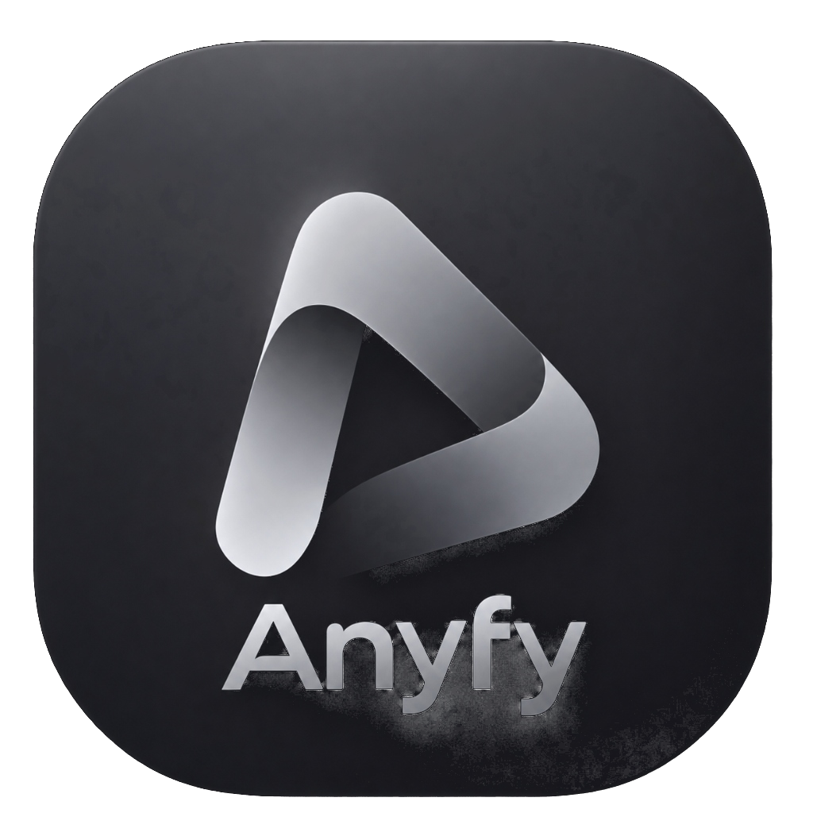

# Anyfy

<div align="center">



### Modern, privacy-respecting Android music player integrated with YouTube Music.

Built with 100% Kotlin, Jetpack Compose (Material 3), and AndroidX Media3.

[](https://github.com/devflins2/anyfy/releases/latest)
[](https://developer.android.com)
[](https://kotlinlang.org)
[](https://developer.android.com/jetpack/compose)
[](LICENSE)

[**Download Latest APK**](https://github.com/devflins2/anyfy/releases/latest) • [**Report Bug**](https://github.com/devflins2/anyfy/issues/new?template=bug_report.md) • [**Request Feature**](https://github.com/devflins2/anyfy/issues/new?template=feature_request.md) • [**Contribute**](CONTRIBUTING.md)

</div>

---

## Overview

**Anyfy** is an open-source Android music streaming client designed for seamless playback from YouTube Music. It provides a clean, distraction-free monochrome grey interface, on-device audio stream resolution without third-party proxy dependencies, real-time synchronized listening rooms ("Together Listening"), and direct account playlist synchronization where YouTube Music serves as the single source of truth.

---

## 📥 Download & Installation

The latest official release APK is signed with Anyfy's production release key and verified with SHA-256 checksums.

### Direct Download Links

| Asset | Details | Link |
| :--- | :--- | :--- |
| **Latest Release Page** | GitHub Releases (Notes & Assets) | [Release v1.0.0](https://github.com/devflins2/anyfy/releases/latest) |
| **Direct APK Download** | Production Signed APK (~71.2 MB) | [Download Anyfy-release.apk](https://github.com/devflins2/anyfy/releases/download/v1.0.0/Anyfy-release.apk) |
| **Version Manifest** | Automated In-App Update Manifest | [`version.json`](https://raw.githubusercontent.com/devflins2/anyfy/main/version.json) |

### Verification Details

- **Package ID:** `com.aistudio.flinsmusic.zrqv`
- **Release Version:** `1.0.0` (Build `100`)
- **Minimum Android Version:** Android 8.0 (API Level 26)
- **Target Android Version:** Android 16 (API Level 36)
- **Signing Scheme:** APK Signature Scheme v2 (RSA 2048-bit, Anyfy Production)
- **Verified SHA-256 Checksum:**
  ```text
  c22f20174fb1efb1c379b8abbc6954bb902542d4167b3956397576eee8b5c94c
  ```

### Step-by-Step Installation Instructions

1. Download **`Anyfy-release.apk`** to your Android device from the [Latest Release](https://github.com/devflins2/anyfy/releases/latest).
2. Open the downloaded file using your device's file manager or browser download notification.
3. If Android displays an **"Install unknown apps"** security prompt:
   - Tap **Settings** on the prompt.
   - Toggle **Allow from this source** for your browser or file manager.
   - Return to the installer.
4. Tap **Install**.
5. Once installed, launch Anyfy from your app drawer.
6. **Automatic Updates:** Anyfy includes a built-in update manager that automatically checks for new releases on launch. When a new release is detected, the app verifies the SHA-256 checksum and cryptographic signature before prompting for a seamless in-app upgrade.

---

## ✨ Features

### Implemented & Verified Features

- **YouTube Music Catalogue Search & Playback:** Direct search and streaming for tracks, albums, artists, and playlists using public YouTube Music InnerTube endpoints.
- **YouTube Music as Single Source of Truth for Playlists:** Create playlists, add songs, and view library collections directly synced with your YouTube Music account.
- **Rich Artist & Album Views:** Complete artist discographies, top tracks, related artists, and full album tracklists with release dates and dynamic wide artwork resolution.
- **On-Device Stream Extraction:** On-device audio extraction using `yt-dlp` without relying on third-party cloud audio proxies.
- **AndroidX Media3 / ExoPlayer Audio Engine:** Background audio playback, media notification controls, lock-screen artwork, audio focus handling, and seamless queue management.
- **Together Listening Rooms:** Synchronized real-time group listening sessions powered by a lightweight Node.js + Socket.IO backend.
- **Personalized Home Feed & Greeting:** Dynamic time-of-day greeting ("Good morning", "Good afternoon", "Good evening") with persistent user preferences and display name.
- **Smart Cache Layer:** Room database cache-first architecture with asynchronous background refresh for fast UI rendering and offline-resilient browsing.
- **Automatic In-App Updates:** Integrated APK download and verification system that fetches version manifests from GitHub Releases with SHA-256 integrity verification.
- **Monochrome Grey UI:** Minimalist dark aesthetic styled with Jetpack Compose Material 3.

### Roadmap & Planned Features

- [ ] Local audio file download and offline playback storage.
- [ ] Time-synced scrolling lyrics view.
- [ ] Android Auto integration.
- [ ] Playback equalizer and audio normalization profiles.
- [ ] Sleep timer and playback speed controls.

---

## 🏗️ Repository & Code Architecture

The Android application source code is organized within the `app/` module:

```text
anyfy/
├── app/                                    # Android Application Module
│   ├── src/main/java/com/example/
│   │   ├── model/                          # Domain models (Track, Album, Artist, Playlist, Manifest)
│   │   ├── player/                         # Media3/ExoPlayer playback service & session management
│   │   ├── service/                        # Service layer & data providers
│   │   │   ├── cache/                      # Room database, entity caches & repository
│   │   │   ├── integrations/ytmusic/       # YouTube Music InnerTube client, parser & facade
│   │   │   ├── simpmusic/                  # Audio extraction & cipher solving engines
│   │   │   ├── together/                   # Together Listening Socket.IO client
│   │   │   └── update/                     # In-app update manager, downloader & integrity verifier
│   │   └── ui/                             # Jetpack Compose UI
│   │       ├── components/                 # Reusable UI widgets & update dialogs
│   │       ├── screens/                    # Home, Search, Album, Artist, Playlist, Player screens
│   │       ├── theme/                      # Monochrome Grey Material 3 theme & typography
│   │       └── viewmodel/                  # Android ViewModels & StateFlow state holders
│   └── src/test/java/com/example/          # Unit & regression test suite (408+ Robolectric/JUnit tests)
├── backend/                                # Node.js + Express + Socket.IO server (Together Listening)
├── .github/
│   ├── ISSUE_TEMPLATE/                     # GitHub Issue templates (bug report, feature request)
│   └── workflows/                          # GitHub Actions release build & publish workflows
├── scripts/                                # Local build & release automation scripts
├── version.json                            # HTTPS version manifest for in-app updates
└── LICENSE                                 # Project license (MIT + GPL-3.0 attribution)
```

---

## 🛠️ Technology Stack

| Layer | Technologies |
| :--- | :--- |
| **Language** | Kotlin 2.0+ |
| **UI Framework** | Jetpack Compose, Material 3, Compose Navigation |
| **Audio Engine** | AndroidX Media3 (ExoPlayer 1.4+), MediaSessionService |
| **Local Storage** | Room DB (SQLite), DataStore, SharedPreferences |
| **Networking** | OkHttp 4, Retrofit 2, Gson, JSON |
| **Image Loading** | Coil Compose |
| **Realtime Group Audio**| Socket.IO Client (Android) + Node.js/Express (Backend) |
| **Stream Extraction**| On-device yt-dlp & cipher solving engines |
| **Build System** | Gradle (Kotlin DSL), Android Gradle Plugin 8.7+ |
| **Testing** | JUnit 4, Robolectric, Kotlinx Coroutines Test, MockWebServer |

---

## 💻 Building from Source

### Prerequisites

- **Android Studio:** Android Studio Ladybug (2024.2+) or newer
- **Java Development Kit:** JDK 17 (recommended: Android Studio embedded JBR 17)
- **Android SDK:** API Level 36 (compileSdk) with Build Tools 35.0.0+
- **Git**

### Clone & Build Steps

1. Clone the repository:
   ```bash
   git clone https://github.com/devflins2/anyfy.git
   cd anyfy
   ```

2. Open the project in Android Studio and let Gradle synchronize dependencies.

3. *(Optional)* Create a `.env` file in the root directory if you wish to configure optional API keys (see `.env.example`).

4. Build the debug APK:
   ```bash
   ./gradlew assembleDebug
   ```
   The debug APK will be generated at:
   `app/build/outputs/apk/debug/app-debug.apk`

5. Run unit and regression tests:
   ```bash
   ./gradlew testDebugUnitTest
   ```

6. Build the signed release APK:
   ```bash
   ./gradlew assembleRelease
   ```
   *Note: Release builds require signing properties configured in `local.properties` or environment variables (`KEYSTORE_PATH`, `STORE_PASSWORD`, `KEY_ALIAS`, `KEY_PASSWORD`).*

### Together Listening Backend (Optional)

The backend server powers real-time room synchronization for the Together Listening feature:

```bash
cd backend
npm install
npm start
```
For full configuration options, see [backend/README.md](backend/README.md).

---

## ⚖️ Licensing & Third-Party Code

### Primary License

The Anyfy application code authored by this project is licensed under the **[MIT License](LICENSE)**:

```text
Copyright (c) 2026 devflins2 and The Anyfy Contributors
```

### Upstream Code Attribution & GPL-3.0 Compliance

Certain components within Anyfy incorporate or adapt code from upstream open-source projects:

- **SimpMusic:** YouTube Music InnerTube JSON parsing and stream cipher extraction modules (`com.example.service.integrations.ytmusic` and `com.example.service.simpmusic`) adapt code from [SimpMusic](https://github.com/maxrave-dev/SimpMusic) by **Nguyễn Đức Tuấn Minh (maxrave-dev)**, licensed under the **GNU General Public License Version 3.0 (GPL-3.0-only)**.
  - Original copyright notices and GPL-3.0 license headers are preserved verbatim in all adapted source files.
  - In accordance with the GNU GPL-3.0, any compiled binary distribution containing these GPL-3.0-covered components is distributed under the terms of the GNU General Public License Version 3.0.
  - Complete, unminified source code for all components is made freely and publicly available in this repository.

### Third-Party Libraries

- **AndroidX & Jetpack Compose:** [Apache License 2.0](http://www.apache.org/licenses/LICENSE-2.0) (The Android Open Source Project / Google LLC)
- **AndroidX Media3 / ExoPlayer:** [Apache License 2.0](http://www.apache.org/licenses/LICENSE-2.0) (Google LLC)
- **OkHttp & Retrofit:** [Apache License 2.0](http://www.apache.org/licenses/LICENSE-2.0) (Square, Inc.)
- **Coil:** [Apache License 2.0](http://www.apache.org/licenses/LICENSE-2.0) (Coil Contributors)
- **Socket.IO Client Java:** [MIT License](https://opensource.org/licenses/MIT) (Automattic, Inc.)
- **youtubedl-android:** [LGPL-3.0 / Apache License 2.0](https://www.gnu.org/licenses/lgpl-3.0.html)

YouTube Music and YouTube are trademarks of Google LLC. Anyfy is an independent project and is not affiliated with, endorsed by, or sponsored by Google LLC or YouTube.

---

## 🔒 Security

For instructions on reporting security vulnerabilities responsibly, please review our **[Security Policy](SECURITY.md)**. Vulnerabilities should be reported via GitHub Private Vulnerability Reporting or directly to repository maintainers.

---

## 🤝 Contributing & Code of Conduct

We welcome community contributions, bug fixes, and suggestions!
- Read our **[Contribution Guide](CONTRIBUTING.md)** for instructions on branching, coding standards, and submitting pull requests.
- Please adhere to our **[Code of Conduct](CODE_OF_CONDUCT.md)** in all project discussions and interactions.

---

<div align="center">
<sub>Crafted with care by <b>devflins2</b> and the Anyfy Open Source Community.</sub>
</div>
